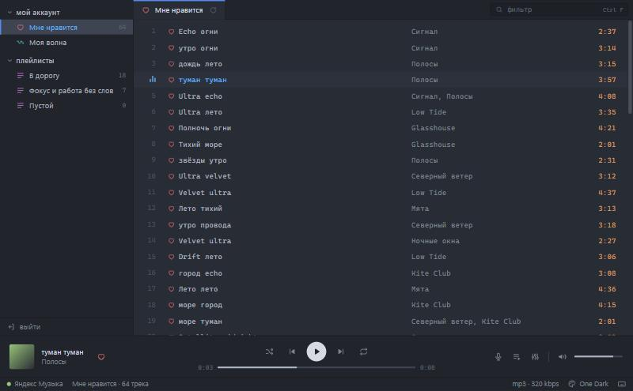
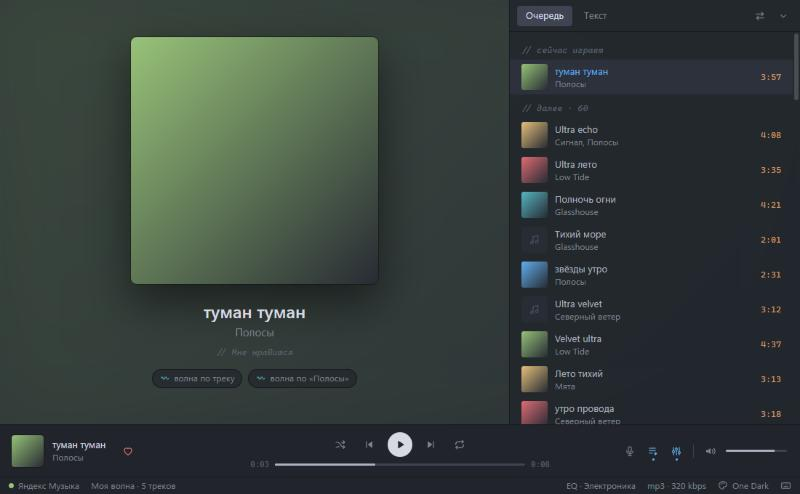
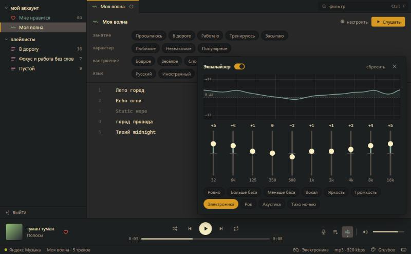

# Яндекс плеер кастом

Минималистичный плеер Яндекс Музыки для Windows, оформленный как редактор кода. Треки идут строками с номерами, как строки кода, плейлисты лежат в дереве слева, как файлы проекта, а внизу строка состояния. Поддерживаются «Моя волна» с настройками, тексты песен, эквалайзер и семь цветовых тем.



> **Неофициальный клиент.** Плеер работает через неофициальную библиотеку [yandex-music](https://github.com/MarshalX/yandex-music-api) и не связан с Яндексом. Для прослушивания треков целиком нужна подписка Яндекс Плюс, без неё Яндекс отдаёт 30-секундные фрагменты.

## Возможности

- **Библиотека.** «Мне нравится», свои плейлисты, фильтр по названию и исполнителю (`Ctrl F`).
- **Вкладки, как в Atom.** Плейлисты, «Моя волна» и исполнители открываются во вкладках. Клик в боковой панели открывает вкладку-предпросмотр курсивом, двойной клик или запуск трека её закрепляет. Вкладки можно перетаскивать и закрывать, а на вкладке, из которой играет музыка, идёт эквалайзер. Открытые вкладки запоминаются между запусками.
- **Исполнители.** Клик по имени исполнителя открывает его вкладку: фото, слушатели за месяц, похожие исполнители и треки по популярности.
- **Моя волна.** Настройки, как в приложении Яндекса: занятие, характер, настроение, язык. Можно запустить волну по треку, исполнителю или плейлисту. Плеер сообщает Яндексу, дослушан трек или пропущен, чтобы рекомендации подстраивались.
- **Плейлисты.** Правым кликом по треку можно добавить его в плейлист, удалить из текущего или создать новый плейлист.
- **Развёрнутый вид.** Клик по обложке внизу открывает её на всё окно. Рядом панель с очередью и текстом песни, её можно поставить слева или справа.
- **Тексты песен.** Сначала плеер берёт текст у Яндекса, а если тот его не отдал, ищет в открытой базе [LRCLIB](https://lrclib.net). Если текст синхронный, текущая строка подсвечивается, а клик по строке перематывает к ней.
- **Эквалайзер.** 10 полос от 32 Гц до 16 кГц, пресеты, график частотной характеристики и живой спектр.
- **Темы.** One Dark, Gruvbox, Blue Topaz, Wasp, GitHub Dark, GitHub Light, Min. Заголовок окна перекрашивается вместе с темой.
- **Панель задач и медиаклавиши.** На превью окна в панели задач есть кнопки «назад / играть / вперёд». Медиаклавиши клавиатуры тоже работают.
- **Остальное.** Лайки, перемешивание, повтор очереди или одного трека. Настройки сохраняются между запусками.

| Развёрнутый вид | «Моя волна» и эквалайзер (тема Gruvbox) |
| --- | --- |
|  |  |

## Установка

### Готовый exe

Если к [релизу](https://github.com/egrikson/Yandex-Player/releases) приложен `Яндекс плеер кастом.exe`, скачайте его и запустите. Устанавливать ничего не нужно. Файл не подписан, поэтому при первом запуске Windows может показать окно SmartScreen: нажмите «Подробнее», затем «Выполнить в любом случае».

### Из исходников

Понадобятся Windows 10 или 11, [Python](https://www.python.org/downloads/) 3.10 или новее (проверено на 3.14) и WebView2 Runtime (в Windows 11 он уже есть).

```bat
git clone https://github.com/egrikson/Yandex-Player.git
cd Yandex-Player
Запустить.bat
```

При первом запуске `Запустить.bat` сам создаст окружение `.venv` и поставит зависимости из `requirements.txt`.

### Сборка exe

```bat
tools\build.bat
```

Скрипт поставит PyInstaller и Pillow, перерисует иконки и соберёт `Яндекс плеер кастом.exe` в корне проекта. Если плеер в это время запущен, старый exe будет переименован, а не удалён, так что сборка не прерывает музыку.

## Вход в аккаунт

1. Нажмите «Войти через Яндекс» и войдите в открывшемся окне Яндекса. Плеер сам заберёт токен и закроет это окно.
2. Если автоматический вход не сработал, нажмите «У меня есть токен» и вставьте токен или адрес страницы с `access_token`.

Токен хранится только на вашем компьютере, в `%APPDATA%\OneDarkPlayer\config.json`. Кнопка «выйти» внизу боковой панели его удаляет.

## Горячие клавиши

| Клавиша | Действие |
| --- | --- |
| `Пробел` | играть / пауза |
| `←` `→` | перемотка на 5 секунд |
| `Ctrl ←` `Ctrl →` | предыдущий / следующий трек |
| `↑` `↓` | громкость |
| `L` | «Мне нравится» |
| `S` | перемешать |
| `R` | повтор: выключен → очередь → трек |
| `T` | текст песни |
| `Q` | очередь |
| `E` | эквалайзер |
| `Ctrl F` | фильтр по списку |
| `Esc` | закрыть панель или сбросить фильтр |
| `Ctrl Tab` `Ctrl Shift Tab` | следующая / предыдущая вкладка |
| `Ctrl 1`…`Ctrl 9` | вкладка по номеру (`Ctrl 9` — последняя) |
| `Ctrl W`, средняя кнопка мыши | закрыть вкладку |
| двойной клик по вкладке или плейлисту | закрепить вкладку |
| клик по исполнителю | вкладка исполнителя |
| правый клик по треку | исполнитель, волна по треку или исполнителю, плейлисты |
| правый клик по вкладке | закрыть другие, справа или все |

Буквенные клавиши работают и на русской раскладке.

## Как устроено

```
app.py            окно pywebview и API для интерфейса: вход, библиотека, волна,
                  плейлисты, тексты, локальный аудио-прокси
taskbar.py        кнопки на превью в панели задач (ITaskbarList3/4 через ctypes)
ui/               интерфейс: index.html, style.css, app.js
ui/themes.js      цветовые темы
ui/mock.js        тестовые данные для отладки интерфейса в браузере
assets/taskbar/   значки кнопок панели задач (светлые и тёмные)
tools/            сборка exe, генератор иконок, свойства exe
Запустить.bat     запуск из исходников
```

Интерфейс — обычная веб-страница внутри окна [pywebview](https://pywebview.flowrl.com/) (WebView2), а Python-часть общается с Яндекс Музыкой. Несколько деталей:

- **Аудио идёт через локальный прокси** на `127.0.0.1`. Прокси добавляет заголовок CORS: без него Web Audio не пропустил бы звук с серверов Яндекса в эквалайзер. Запросы с диапазоном байт (Range) проходят насквозь, поэтому перемотка работает. Если ссылка на трек протухла, прокси сам получает новую.
- **Интерфейс раздаётся на постоянном порту** `127.0.0.1:47813`, если он свободен, а иначе на любом свободном. Порт проверяется эксклюзивно, чтобы два запущенных экземпляра не подхватывали файлы друг друга.
- **Настройки** (тема, эквалайзер, громкость, параметры волны) хранятся в `config.json` рядом с токеном, а не в `localStorage` браузера.

### Отладка интерфейса в браузере

Интерфейс можно открыть без Python-части, на тестовых данных:

```bat
.venv\Scripts\python.exe -m http.server 8766 --directory ui
```

Затем откройте в браузере `http://localhost:8766/index.html?mock&auth`. Без `&auth` откроется экран входа.

## Данные и приватность

- Всё, что плеер сохраняет, лежит в `%APPDATA%\OneDarkPlayer`: `config.json` (токен и настройки), `player.log` (журнал ошибок) и `webview\` (профиль встроенного браузера). Если удалить эту папку, плеер забудет вход и настройки.
- Сетевые запросы идут к серверам Яндекс Музыки и, только для поиска текстов, к `lrclib.net`.
- Папка данных называется по прежнему имени проекта (One Dark Player), чтобы после переименования не потерялись вход и настройки.

## Благодарности

- [yandex-music](https://github.com/MarshalX/yandex-music-api) — неофициальная Python-библиотека для API Яндекс Музыки.
- [pywebview](https://github.com/r0x0r/pywebview) — окно с веб-интерфейсом на Python.
- [LRCLIB](https://lrclib.net) — открытая база синхронных текстов песен.
- Цветовые палитры навеяны темами One Dark (Atom), Gruvbox, Blue Topaz, Wasp, GitHub и Min.
